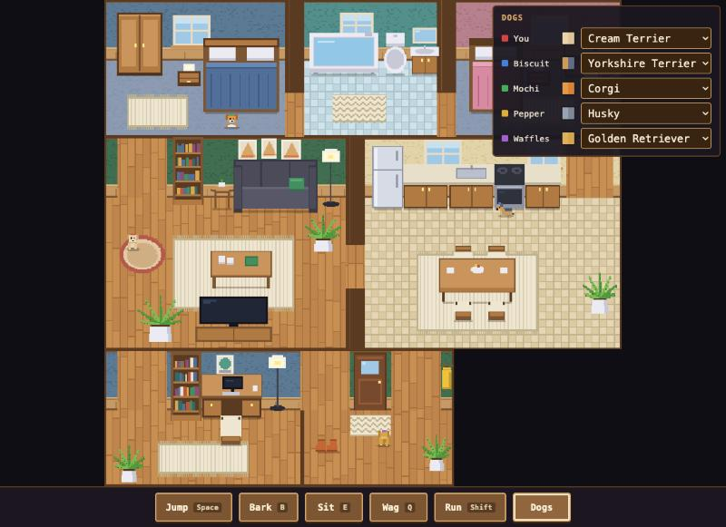
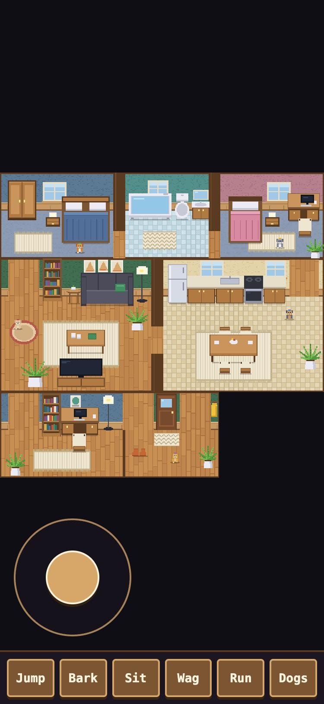

# Pixel Pup

A pixel-art browser game where you play with a pet dog. Walk it around a house with a patio and garden, with four other dogs, pick every dog's breed, and make yours jump, bark, run, and more.

> Status: early. You can walk your dog around the house, patio, and garden while four other dogs wander on their own, and you can change every dog's breed. Jump, bark, sit, and wag work from keys and on-screen buttons. The map fills the window without stretching.

## Screenshots

<p>
  
  
</p>

*Left: desktop, with the breed selector open. Right: phone, with the on-screen joystick.*

## Concept

- Top-down pixel-art, single-level house with **7 rooms** connected by doorways: master bedroom, bathroom, kids' bedroom, living room, kitchen, office, and entry. A back door leads from the kitchen to a **patio**, and a gate from the patio to a **garden**.
- A **Zoom** button zooms in on the room your dog is in; the view glides to the next room when your dog walks through a doorway, and **Exit zoom** brings back the whole house.
- You control a dog with the keyboard. Four more dogs wander the house on their own: they walk, run, jump, bark, wag, and sit.
- A **breed selector** (the Dogs button) lets you pick the breed of every dog, including yours.
- **Collisions** keep the dog out of walls and furniture, so nothing overlaps.
- On-screen **action buttons** trigger pet actions: jump, bark, and others to come.

## Controls

| Input | Action |
|---|---|
| Arrow keys / WASD | Move the dog |
| Shift (or the Run button) | Run |
| Space | Jump |
| B | Bark |
| E | Sit (press again, or walk, to stand) |
| Q | Wag tail |
| On-screen joystick (touch devices) | Move the dog |
| On-screen buttons | Same actions as the keys, by mouse or touch |

Keys and buttons trigger the same actions, so the two never drift apart.

## Planned stack

- **React + TypeScript**, built with **Vite**.
- **HTML canvas** for the game world, drawn with image smoothing off to keep pixels crisp.
- React for the UI around the canvas (buttons, HUD).
- No game engine at first. The scope is small enough for a plain game loop.

## Planned structure

```
src/
  game/        # pure game logic, no React: loop, dog, world, collisions
  render/      # canvas drawing and sprite handling
  ui/          # React components: canvas host, action buttons
  assets/      # sprites and sounds
```

## Roadmap

1. ~~Project scaffold (Vite, React, TypeScript, tests).~~
2. ~~House layout with 7 rooms, walls, doorways, furniture, and collision data.~~
3. ~~Game loop, Yorkie sprite, and keyboard-driven movement with collisions.~~
4. ~~Jump, bark, sit, and wag with animations.~~
5. ~~Action buttons wired to the same actions as the keyboard.~~
6. ~~Four wandering dogs and a breed selector.~~
7. ~~Patio, garden, and a zoom view that follows your dog from room to room.~~
8. Breeds with different shapes (ears, size), more actions, furniture, sounds.

## Playing on iPhone or iPad

Touch devices get an on-screen joystick in the bottom-left corner, so no keyboard is needed. Drag it to walk, use the **Run** button to keep running, and the other buttons for jump, bark, sit, and wag.

To try it on your own phone or tablet while developing, put it on the same Wi-Fi as your computer and run:

```bash
npm run dev:lan
```

Then open the `Network` address Vite prints (for example `http://192.168.1.20:5173`) in Safari. For a full-screen game without Safari's toolbars, tap Share, then **Add to Home Screen**. The dev server is open to your local network while `dev:lan` runs, so stop it when you are done.

## Getting started

```bash
npm install
npm run dev     # http://localhost:5173
npm run dev:lan # same, but reachable from phones on your Wi-Fi
npm test        # game logic tests
```
